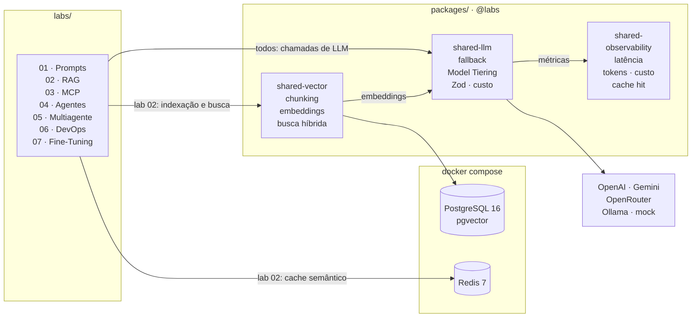

# AI Engineering Labs

[](https://www.typescriptlang.org/)
[](https://nodejs.org/)
[](https://pnpm.io/)
[](https://turborepo.dev/)
[](docker-compose.yml)
[](LICENSE)

Monorepo de laboratórios práticos de **Engenharia de IA aplicada**, em TypeScript. Cada laboratório isola um padrão usado em produção (RAG híbrido, MCP, agentes, multiagente com aprovação humana, AIOps, datasets de fine-tuning) em um exemplo pequeno, executável e medido.

Três decisões valem para todos os laboratórios:

- **Toda chamada de LLM passa por um wrapper único.** `@labs/shared-llm` faz fallback entre provedores, escolhe a faixa de modelo pela complexidade e devolve saída já validada com Zod.
- **Toda chamada é medida.** Modelo, latência, tokens, custo estimado e cache hit, em uma linha por chamada.
- **Tudo roda sem chave de API.** Um provedor `mock` determinístico deixa clonar, rodar e passar no CI sem rede. Com uma chave no `.env`, os mesmos exemplos falam com modelos reais.

```text
[10:59:44] INFO: [MODEL] mock-fast [LATENCY_MS] 0 [TOKENS_IN/OUT] 126/38 [ESTIMATED_COST_USD] 0.000000 [CACHE_HIT] false · triage:extract
```

## Arquitetura

Os laboratórios não falam com provedores nem com o banco diretamente: consomem os três pacotes compartilhados, e é neles que ficam fallback, validação, custo e métricas.



| Pacote | O que resolve |
| --- | --- |
| [`@labs/shared-llm`](packages/shared-llm) | Um adaptador para os quatro provedores (todos falam o protocolo da OpenAI), cadeia de fallback, roteador por complexidade (`fast` / `balanced` / `powerful`), `generateObject` com schema Zod e nova tentativa quando a saída não valida, custo estimado por tabela de preços, provedor `mock`. |
| [`@labs/shared-vector`](packages/shared-vector) | Chunking por parágrafo, frase e palavra com overlap, ingestão transacional, busca vetorial (cosseno, HNSW), lexical (full-text search, GIN) e híbrida (Reciprocal Rank Fusion). |
| [`@labs/shared-observability`](packages/shared-observability) | Logger Pino em stderr, a linha de métricas com `[MODEL]`, `[LATENCY_MS]`, `[TOKENS_IN/OUT]`, `[ESTIMATED_COST_USD]` e `[CACHE_HIT]`, e o acumulado por experimento. |

## Roadmap e progresso dos laboratórios

`Em progresso` quer dizer: o exemplo-base está implementado, roda de ponta a ponta e é exercitado no CI com o provedor mock. Falta medir com modelos reais e preencher a tabela de métricas do laboratório.

| # | Laboratório | Status | Conceitos-chave | Stack |
| --- | --- | --- | --- | --- |
| 01 | [Prompt Engineering & Evals](labs/01-prompt-engineering-evals) | Em progresso | Prompt chaining, saída estruturada, política em código, suíte de regressão com piso de acurácia | Zod, `node:test` |
| 02 | [RAG Patterns](labs/02-rag-patterns) | Em progresso | Busca vetorial × híbrida com RRF explícito, cache semântico com escopo, roteamento por intenção, Agentic RAG com relevance grader | pgvector, full-text search, Redis |
| 03 | [MCP Servers](labs/03-mcp-servers) | Em progresso | Tools, Resources, transporte stdio, validação de entrada, tool que chama LLM | `@modelcontextprotocol/sdk` |
| 04 | [Agent Architectures](labs/04-agent-architectures) | Em progresso | ReAct, Plan-and-Execute, Reflection, tetos de passos | LangGraph |
| 05 | [Multi-Agent Systems](labs/05-multi-agent-systems) | Em progresso | Supervisor, hierárquico com subgrafos, `interrupt` e retomada, aprovação humana obrigatória | LangGraph, checkpointer |
| 06 | [AI DevOps Copilot](labs/06-ai-devops-copilot) | Em progresso | ReAct sem framework, ferramentas somente leitura, dry-run de manifesto, defesa contra injeção via log | `yaml`, Zod |
| 07 | [Fine-Tuning Datasets](labs/07-fine-tuning-datasets) | Em progresso | Decision framework (prompt × RAG × fine-tuning), dataset JSONL com gate de PII, quase duplicatas e alertas de qualidade, teste A/B com projeção de economia, plano de treino LoRA/QLoRA, harness de checkpoints (overfitting e catastrophic forgetting) e payback com NPV em 12 meses | Zod, `node:crypto` |

Próximos experimentos:

| Laboratório | Experimento | Status |
| --- | --- | --- |
| 01 | Juiz LLM com rubrica para avaliar o texto da resposta, além da classificação | Planejado |
| 02 | Reranker depois da fusão e BM25 de verdade no lugar da full-text search | Planejado |
| 03 | Transporte Streamable HTTP com autenticação | Planejado |
| 04 | Tool calling nativo do provedor e nó de replanejamento | Planejado |
| 05 | Checkpointer persistente, com a pausa e a retomada em processos separados | Planejado |
| 06 | Adaptador real de `kubectl` e aprovação humana para aplicar a correção | Planejado |
| 07 | Disparo do treino e avaliação com centenas de exemplos | Planejado |

## Setup rápido

Pré-requisitos: **Node.js 22 ou mais novo**, **pnpm 12** (`corepack enable` ativa a versão fixada no `package.json`) e **Docker** (só o laboratório 02 precisa).

```bash
# 1. Clonar
git clone https://github.com/Amad3eu/ai-engineering-labs.git
cd ai-engineering-labs

# 2. Variáveis de ambiente. As chaves são opcionais: sem elas, roda com o provedor mock.
cp .env.example .env

# 3. Infra local: PostgreSQL com pgvector e Redis
docker compose up -d

# 4. Dependências
pnpm install

# 5. Rodar um laboratório
pnpm --filter @labs/02-rag-patterns dev
```

Sem Docker, comece pelo laboratório 01, que não usa banco:

```bash
pnpm --filter @labs/01-prompt-engineering-evals dev
```

| Comando | O que faz |
| --- | --- |
| `pnpm --filter @labs/<nome> dev` | Roda o exemplo de um laboratório |
| `pnpm check` | Lint, typecheck, build e testes de tudo. É o que o CI roda |
| `pnpm test` | Só os testes |
| `pnpm lint:fix` | Formata e corrige o que o Biome consegue |
| `docker compose down -v` | Derruba a infra e apaga os dados |

Para usar um modelo de verdade, preencha uma das chaves no `.env`. Com mais de uma, a ordem de `LLM_PROVIDERS` define o fallback.

## Princípios de engenharia aplicados

**Determinismo vs. IA.** O modelo decide só o que precisa de julgamento; o que é regra fica em código, testável e igual em toda execução. No lab 01 a prioridade de uma indisponibilidade é imposta por uma função depois do modelo. Nos agentes, teto de passos e de rodadas não depende de o modelo saber parar. O roteador de modelos é uma heurística, não outra chamada de LLM. No CI, o provedor mock torna a suíte reproduzível.

**Observabilidade de custos.** Não existe chamada de LLM sem registro: o wrapper é o único caminho até um provedor e mede todas. O custo sai de uma tabela de preços por modelo, e um modelo sem preço cadastrado gera aviso em vez de aparecer como custo zero. Cada laboratório fecha com o total do experimento, que é o que vai para a tabela de métricas do README.

**Validação estrita com Zod.** Toda entrada externa passa por schema antes de ser usada: a saída do modelo, a resposta da pessoa no fluxo de aprovação, o conteúdo lido do Redis, o YAML de um manifesto, o resultado de uma tool MCP. Quando a saída do modelo não valida, o erro volta para ele uma vez; se insistir, a chamada passa para o próximo provedor.

**Guardrails e Human-in-the-Loop.** O limite é dado pelo que o agente consegue fazer, não pelo que o prompt pede. O copiloto de DevOps não tem ferramenta de escrita. O supervisor multiagente não tem a opção de encerrar: o trabalho só termina com aprovação humana, por `interrupt` e retomada. A entrada do modelo nunca compõe caminho de arquivo. Conteúdo de terceiros (ticket, log, documento) vai entre tags e é tratado como dado, não como instrução.

## Decisões de projeto

- **Um adaptador, quatro provedores.** OpenAI, Gemini, OpenRouter e Ollama expõem o mesmo protocolo de `/chat/completions`. O wrapper troca a URL base e a chave, em vez de manter quatro integrações.
- **Faixa de modelo, não nome de modelo.** O código pede `fast`, `balanced` ou `powerful`, e cada provedor traduz. É o que permite o fallback trocar de provedor sem mudar o tipo de trabalho pedido.
- **Embedding não tem fallback.** Vetores de modelos diferentes não se comparam, e misturá-los estraga a busca sem dar erro. O índice e o cache guardam o modelo de cada vetor.
- **A busca lexical é a full-text search do Postgres**, não BM25: acha o termo exato que o embedding dilui, mas não normaliza pelo tamanho do documento. A troca por BM25 de verdade está no roadmap.
- **Pacotes em modo fonte no desenvolvimento.** Uma condição de export (`@labs/source`) faz os laboratórios resolverem `@labs/shared-*` direto para o TypeScript: sem build para rodar, sem versão velha em `dist/`.
- **Node.js 22 como piso.** O SDK atual da OpenAI exige, e o Node 20 saiu de suporte em abril de 2026.

## Estrutura

```text
ai-engineering-labs/
├── .github/workflows/ci.yml     lint, typecheck, build e test via Turborepo
├── packages/
│   ├── shared-llm/              provedores, fallback, Model Tiering, Zod, custo
│   ├── shared-vector/           pgvector, chunking, busca híbrida
│   └── shared-observability/    logger e métricas
├── labs/
│   ├── 01-prompt-engineering-evals/
│   ├── 02-rag-patterns/
│   ├── 03-mcp-servers/
│   ├── 04-agent-architectures/
│   ├── 05-multi-agent-systems/
│   ├── 06-ai-devops-copilot/
│   └── 07-fine-tuning-datasets/
├── infra/init.sql               extensão vector, tabelas, índices HNSW e GIN
├── docker-compose.yml           PostgreSQL 16 + pgvector e Redis 7
├── CLAUDE.md · .cursorrules     regras de arquitetura para agentes de IA
└── turbo.json · pnpm-workspace.yaml · tsconfig.base.json · biome.json
```

Cada laboratório tem o próprio README, com objetivo, diagrama do fluxo, como rodar e a tabela de trade-offs e métricas.

## Licença

[MIT](LICENSE)
