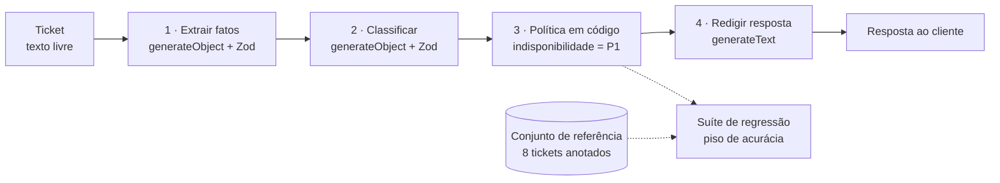

# Lab 01 · Prompt Engineering & Evals

## Objetivo Técnico

Triar tickets de suporte com uma **cadeia de prompts** em que cada passo tem uma tarefa só e devolve **saída estruturada** validada por Zod, e proteger essa cadeia com uma **suíte de regressão**: um conjunto de tickets com a resposta certa anotada e um piso de acurácia que uma mudança de prompt ou de modelo não pode derrubar.

O laboratório mostra três coisas:

- separar extração de classificação deixa cada prompt simples e mostra em qual passo um erro nasceu;
- regra de negócio (indisponibilidade é sempre P1) fica em código, depois do modelo, e não depende de ele acertar;
- "o prompt novo é melhor?" vira um número comparável, em vez de uma impressão.

## Arquitetura e Fluxo



| Arquivo | Papel |
| --- | --- |
| `src/chain.ts` | Os schemas, a política e a cadeia |
| `src/prompts.ts` | Os prompts, separados da lógica |
| `src/evals.ts` | O conjunto de referência e o cálculo de acurácia |
| `src/evals.test.ts` | A suíte de regressão, com os pisos |
| `src/mock.ts` | Roteiro do provedor mock |

## Como Executar

```bash
# Uma passada pela cadeia e a tabela do conjunto de referência
pnpm --filter @labs/01-prompt-engineering-evals dev

# A suíte de regressão
pnpm --filter @labs/01-prompt-engineering-evals test
```

Não precisa de Docker. Sem chave no `.env`, roda com o provedor mock: regras de palavra-chave fazem o papel do modelo, o que valida o encadeamento e os schemas, mas **não mede qualidade de prompt**. Com uma chave, os mesmos comandos avaliam o modelo real. O fluxo de trabalho é: rodar a suíte, mexer em `src/prompts.ts`, rodar de novo e comparar.

## Trade-offs e Métricas Observadas

- **Cadeia contra prompt único.** Dois passos estruturados custam duas chamadas e mais latência; em troca, cada um pode usar o modelo mais barato que dá conta e falha de forma localizável.
- **Política em código contra instrução no prompt.** A regra em código nunca falha, mas só cobre o que dá para escrever como condição. O que exige julgamento continua com o modelo.
- **Conjunto de referência pequeno.** Oito casos pegam regressão grosseira. Um caso errado muda a acurácia em 12 pontos: o piso não distingue diferenças finas entre modelos.

Preencha com a saída de `dev` usando um provedor real. Os números do modo mock não valem como medida.

| Modelo | Acurácia de categoria | Acurácia de prioridade | Chamadas | Latência média (ms) | Custo estimado (USD) |
| --- | --- | --- | --- | --- | --- |
| `gpt-6-luna` | — | — | — | — | — |
| `gemini-3.5-flash-lite` | — | — | — | — | — |
| Ollama (`llama3.2`) | — | — | — | — | — |
