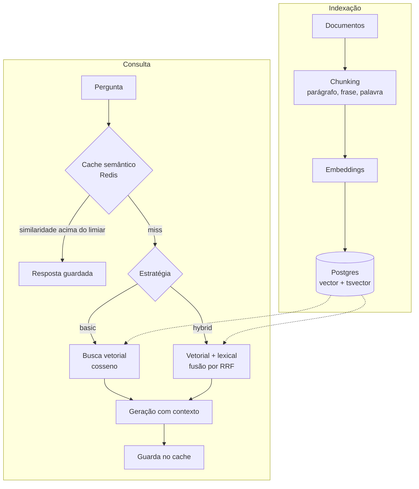

# Lab 02 · RAG Patterns

## Objetivo Técnico

Comparar, nas mesmas perguntas e com a mesma geração, duas estratégias de recuperação, e medir o que um cache semântico tira de custo e latência:

- **Basic RAG**: busca vetorial, os chunks mais próximos por distância de cosseno (pgvector, índice HNSW);
- **Hybrid Search**: a busca vetorial somada a uma busca lexical, fundidas por Reciprocal Rank Fusion;
- **Semantic Cache**: respostas guardadas no Redis e recuperadas pela similaridade do embedding da pergunta, não pelo texto.

O corpus mistura de propósito perguntas com identificador exato (`ERR-4012`, `X-RateLimit-Remaining`), onde a busca lexical é forte, e perguntas com vocabulário diferente do documento ("cópias de segurança" × "backup"), onde a semântica é forte.

A busca lexical aqui é a full-text search do Postgres (`ts_rank_cd` sobre índice GIN). Ela faz o papel do BM25 na busca híbrida, mas não é BM25: não satura a frequência do termo nem normaliza pelo tamanho do documento.

## Arquitetura e Fluxo



| Arquivo | Papel |
| --- | --- |
| `src/corpus.ts` | Os documentos e as perguntas, cada uma com a fonte esperada |
| `src/rag.ts` | As duas estratégias e a geração |
| `src/semantic-cache.ts` | O cache semântico sobre o Redis |
| `src/benchmark.ts` | As medições: recall@k, MRR, latência, custo, acertos de cache |
| `src/prompts.ts` | O prompt de resposta com contexto |

## Como Executar

```bash
# Na raiz: Postgres com pgvector e Redis
cp .env.example .env
docker compose up -d

pnpm --filter @labs/02-rag-patterns dev

# Testes do cache semântico (não precisam da infra)
pnpm --filter @labs/02-rag-patterns test
```

A saída traz duas tabelas: a comparação das estratégias e as três passadas do cache (vazio, mesmas perguntas, paráfrases). Sem a infra no ar, o laboratório avisa e sai.

Sem chave no `.env`, o embedding vem do provedor mock, que é um hash de palavras: não entende sinônimo, então o recall e os acertos de paráfrase **só valem com um provedor real**. Ao trocar de provedor, rode de novo: a indexação refaz os embeddings.

## Trade-offs e Métricas Observadas

- **Híbrida contra vetorial.** A híbrida recupera o identificador exato que o embedding dilui, ao custo de uma segunda busca e de mais um índice para manter. Em corpus sem termos raros, o ganho tende a sumir.
- **Limiar do cache.** Baixo demais devolve a resposta de outra pergunta, que é um erro silencioso. Alto demais quase não acerta. O valor depende do modelo de embedding e precisa ser calibrado com perguntas reais.
- **Custo fixo do cache.** Toda consulta paga um embedding, acerte ou não. Só compensa quando há repetição.
- **Cache compartilhado.** Uma resposta montada com os documentos de um usuário pode ser servida a outro. Em sistema com permissões, o `namespace` do cache precisa carregar o escopo de acesso.
- **Varredura linear.** O cache compara a pergunta com todas as entradas. Serve até alguns milhares; acima disso pede um índice vetorial.

Preencha com a saída de `dev` usando um provedor real.

| Estratégia | recall@3 | MRR | Busca (ms) | Total por pergunta (ms) | Tokens in/out | Custo estimado (USD) |
| --- | --- | --- | --- | --- | --- | --- |
| Basic RAG | — | — | — | — | — | — |
| Hybrid Search | — | — | — | — | — | — |

| Passada do cache | Cache hits | Similaridade média | Latência média (ms) | Custo estimado (USD) |
| --- | --- | --- | --- | --- |
| 1ª: cache vazio | — | — | — | — |
| 2ª: mesmas perguntas | — | — | — | — |
| 3ª: paráfrases | — | — | — | — |

Modelo de geração: — · Modelo de embedding: — · Limiar do cache: 0,92
