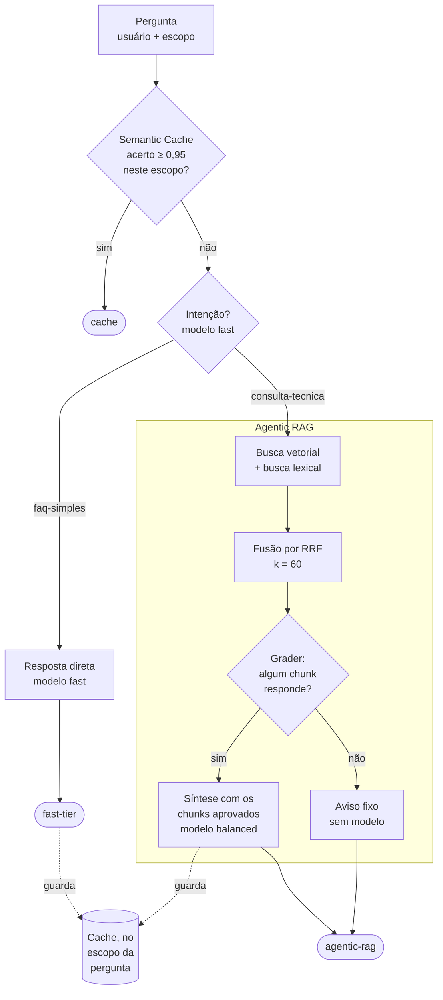

# Lab 02 · RAG Patterns

## Objetivo Técnico

Montar, peça por peça, o caminho que uma pergunta percorre em um sistema de RAG de produção, e medir o que cada peça economiza ou protege. O laboratório tem duas partes.

**Recuperação.** Duas estratégias nas mesmas perguntas, com a mesma geração:

- **Basic RAG**: busca vetorial, os chunks mais próximos por distância de cosseno (pgvector, índice HNSW);
- **Hybrid Search**: a busca vetorial somada a uma busca lexical, fundidas por **Reciprocal Rank Fusion**. A fusão é uma função pura, `reciprocalRankFusion(vectorResults, lexicalResults, k = 60)`, com testes que provam a propriedade que interessa: um chunk bem colocado nas duas buscas passa na frente do primeiro colocado de uma só.

**Pipeline de decisão.** Um orquestrador que, para cada pergunta, escolhe o caminho mais barato que ainda responde certo:

1. **Semantic Cache**, com limiar de similaridade configurável (padrão 0,95) e isolamento por escopo: resposta `global` serve a todos, resposta `user-private` só volta para o dono;
2. **Intent-Based Routing**: o modelo barato classifica a pergunta em `faq-simples` ou `consulta-tecnica`;
3. `faq-simples` é respondida direto pelo modelo mais barato, sem busca;
4. `consulta-tecnica` vai para o **Agentic RAG**: busca híbrida, um **relevance grader** que julga se cada chunk responde mesmo à pergunta, e a síntese só com os chunks aprovados. Sem nenhum chunk aprovado, sai um aviso fixo, sem chamar o modelo.

A busca lexical aqui é a full-text search do Postgres (`ts_rank_cd` sobre índice GIN). Ela faz o papel do BM25 na busca híbrida, mas não é BM25: não satura a frequência do termo nem normaliza pelo tamanho do documento.

## Arquitetura e Fluxo



As três saídas arredondadas são a coluna `fonte` do benchmark. A linha pontilhada é a gravação no cache: a resposta direta e a síntese entram; o aviso fixo, não.

Quem lê e quem grava no cache, por escopo da pergunta:

| Pergunta feita em | Grava em | Pode ler |
| --- | --- | --- |
| `global` | `global` | só `global` |
| `user-private` | entradas do próprio usuário | as do próprio usuário e `global` |

Uma pergunta `global` nunca enxerga entrada privada, nem a do próprio usuário: a resposta pode ir para uma tela que outras pessoas veem. O escopo é decidido pela aplicação, não pelo modelo.

| Arquivo | Papel |
| --- | --- |
| `src/rrf.ts` | A função pura de Reciprocal Rank Fusion |
| `src/rag.ts` | As estratégias de recuperação (`basic`, `hybrid`) e a geração com contexto |
| `src/semantic-cache.ts` | O cache semântico sobre o Redis, com limiar e escopo |
| `src/pipeline.ts` | O orquestrador: cache, roteador, modelo barato, Agentic RAG com grader |
| `src/prompts.ts` | Os prompts do roteador, do grader e das respostas |
| `src/corpus.ts` | Os documentos, as perguntas de recuperação e a bateria do pipeline |
| `src/benchmark.ts` | As medições: recall@k e MRR, e a tabela da bateria |
| `src/mock.ts` | Roteiro do provedor mock |
| `src/memory-store.ts` | Substituto do Redis em memória, para os testes |

## Como Executar

```bash
# Na raiz: Postgres com pgvector e Redis
cp .env.example .env
docker compose up -d

pnpm --filter @labs/02-rag-patterns dev

# Testes: RRF, cache com escopo e o pipeline inteiro. Não precisam da infra nem de chave.
pnpm --filter @labs/02-rag-patterns test
```

A saída traz duas tabelas: a comparação das estratégias de recuperação e a bateria do pipeline, com seis perguntas na ordem em que foram feitas. Sem a infra no ar, o laboratório avisa e sai.

Sem chave no `.env`, tudo roda com o provedor mock: o embedding é um hash de palavras, e o roteador e o grader são regras de palavra-chave. O fluxo de decisão aparece inteiro, mas recall, latência, custo e acerto de paráfrase **só valem com um provedor real**. Ao trocar de provedor, rode de novo: a indexação refaz os embeddings.

Para experimentar: mude o `threshold` do cache em `src/index.ts`, ou troque a pergunta 2 da bateria (`src/corpus.ts`) por uma paráfrase com sinônimos.

## Trade-offs e Métricas Observadas

- **Fusão na aplicação contra fusão no banco.** Aqui o RRF roda em TypeScript, sobre duas consultas em paralelo: dá para testar sem banco, ver a posição de cada chunk em cada lista e trocar uma das buscas por outra fonte. `hybridSearch`, de `@labs/shared-vector`, faz a mesma fusão dentro do SQL, em uma ida só ao banco.
- **Híbrida contra vetorial.** A híbrida recupera o identificador exato que o embedding dilui, ao custo de uma segunda busca e de mais um índice para manter. Em corpus sem termos raros, o ganho tende a sumir.
- **Limiar do cache.** Baixo demais devolve a resposta de outra pergunta, que é um erro silencioso. Alto demais quase não acerta: em 0,95, uma paráfrase com sinônimos pode ficar de fora. O valor depende do modelo de embedding e precisa ser calibrado com perguntas reais.
- **Escopo do cache.** Sem ele, a resposta escrita com os dados de uma pessoa é servida à próxima que perguntar algo parecido. O preço é menos acerto: conversa privada não aproveita a resposta privada de outro usuário, mesmo quando seria igual.
- **Roteador por modelo.** Custa uma chamada em toda pergunta que não acerta o cache, e pode errar. O erro caro é mandar uma pergunta do manual para o caminho sem documentos; por isso a instrução manda escolher `consulta-tecnica` na dúvida, e o caminho barato é proibido de citar regra da empresa.
- **Relevance grader.** A busca sempre devolve os k chunks mais próximos, mesmo quando nenhum responde. O grader barra a síntese sobre trecho que só fala de assunto parecido, e custa uma chamada do modelo barato por chunk.
- **Aviso fixo no fallback.** Texto fixo não custa nada e não inventa. Ele não entra no cache: deixaria de valer no dia em que o documento que falta fosse indexado.

O que cada caminho gasta, por construção, com 3 chunks por busca:

| Caminho | Embeddings | Chamadas ao modelo |
| --- | --- | --- |
| `cache` | 1 (a pergunta) | 0 |
| `fast-tier` | 1 | 2: intenção e resposta, as duas na faixa `fast` |
| `agentic-rag` | 2 (cache e busca) | 5: intenção, 3 notas do grader (`fast`) e a síntese (`balanced`) |
| `agentic-rag`, sem chunk aprovado | 2 | 4: intenção e 3 notas do grader. Não há síntese |

### Bateria do pipeline em modo mock

Execução de 18/11/2026, sem chave de API. Mostra o fluxo de decisão funcionando. Latência e custo ficaram de fora de propósito: o mock responde em milissegundos e não custa nada. Os tokens são estimados pelo tamanho dos prompts.

| # | Pergunta | Usuário · escopo | Fonte | Decisão | Tokens in/out |
| --- | --- | --- | --- | --- | --- |
| 1 | O que significa o erro ERR-4012? | ana · global | `agentic-rag` | 1 de 3 chunks aprovados | 839/99 |
| 2 | O erro ERR-4012 significa o quê? | bruno · global | `cache` | similaridade 1,00 com a pergunta 1 | 8/0 |
| 3 | O que significa a sigla API? | ana · global | `fast-tier` | intenção `faq-simples` | 259/43 |
| 4 | O que fazer quando aparece ERR-4031? | ana · user-private | `agentic-rag` | 1 de 3 chunks aprovados | 867/99 |
| 5 | O que fazer quando aparece ERR-4031? | bruno · user-private | `agentic-rag` | 1 de 3 chunks aprovados: a resposta privada da Ana não foi servida | 867/99 |
| 6 | Qual é a política de reembolso de viagens a trabalho? | ana · global | `agentic-rag` | 0 de 3 chunks aprovados: aviso fixo | 678/80 |

A pergunta 2 acerta o cache no mock porque usa as mesmas palavras da 1 em outra ordem, e o embedding do mock é um hash de palavras. Uma paráfrase com sinônimos só acerta com um modelo de embedding de verdade.

### Bateria do pipeline com provedor real

Preencha com a saída de `dev`. A coluna `esperada` da saída mostra quando a fonte diverge do previsto, o que indica limiar ou roteador a calibrar.

| # | Fonte | Decisão | Modelo | Latência (ms) | Tokens in/out | Custo estimado (USD) |
| --- | --- | --- | --- | --- | --- | --- |
| 1 | — | — | — | — | — | — |
| 2 | — | — | — | — | — | — |
| 3 | — | — | — | — | — | — |
| 4 | — | — | — | — | — | — |
| 5 | — | — | — | — | — | — |
| 6 | — | — | — | — | — | — |

Modelos por faixa: `fast` — · `balanced` — · Modelo de embedding: — · Limiar do cache: 0,95

### Recuperação com provedor real

| Estratégia | recall@3 | MRR | Busca (ms) | Total por pergunta (ms) | Tokens in/out | Custo estimado (USD) |
| --- | --- | --- | --- | --- | --- | --- |
| Basic RAG | — | — | — | — | — | — |
| Hybrid Search (RRF) | — | — | — | — | — | — |
