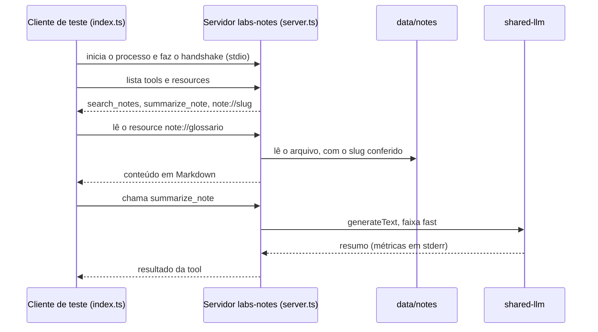

# Lab 03 · MCP Servers

## Objetivo Técnico

Escrever um **servidor MCP** (Model Context Protocol) em TypeScript que expõe uma pasta de notas Markdown a qualquer cliente compatível, e um **cliente de teste** que percorre o protocolo de ponta a ponta.

O servidor `labs-notes` oferece as duas primitivas principais:

- **Resources** (`note://{slug}`): dado que o cliente lê e anexa ao contexto do modelo;
- **Tools**: ações que o modelo pede. `search_notes` busca um termo; `summarize_note` chama um LLM por dentro, passando pelo mesmo wrapper e pelas mesmas métricas dos outros laboratórios.

Três cuidados que o exemplo deixa visíveis: nada além do protocolo vai para stdout; a entrada do modelo nunca compõe um caminho de arquivo; erro de tool volta como resultado, para o modelo poder se corrigir.

## Arquitetura e Fluxo



| Arquivo | Papel |
| --- | --- |
| `src/server.ts` | O servidor: registro de resources e tools, transporte stdio |
| `src/index.ts` | O cliente de teste |
| `src/prompts.ts` | O prompt de resumo |
| `data/notes/` | As notas expostas |

## Como Executar

```bash
# Cliente de teste: sobe o servidor, lista, lê e chama as tools
pnpm --filter @labs/03-mcp-servers dev
```

Não precisa de Docker. Sem chave no `.env`, `summarize_note` devolve um eco do provedor mock.

Para ligar o servidor a um cliente MCP de verdade, aponte o cliente para o comando abaixo, com o caminho absoluto do laboratório. O `--dir` faz o comando funcionar de qualquer pasta, e o `--silent` garante que só o protocolo saia em stdout.

```bash
pnpm --silent --dir /caminho/para/ai-engineering-labs/labs/03-mcp-servers server
```

No Claude Code, a partir da raiz do repositório:

```bash
claude mcp add labs-notes -- pnpm --silent --dir "$PWD/labs/03-mcp-servers" server
```

## Trade-offs e Métricas Observadas

- **Tool contra Resource.** Tool é decisão do modelo e custa uma ida e volta a mais; Resource é decisão do cliente e entra direto no contexto. Dado que o modelo sempre precisa ler é resource; ação com parâmetro é tool.
- **stdio contra HTTP.** stdio não tem rede nem autenticação para configurar, e serve um cliente por processo. Para vários clientes ou servidor remoto, o transporte é Streamable HTTP, com autenticação na frente.
- **LLM dentro da tool.** O servidor passa a ter custo e latência próprios, que o cliente não vê. Por isso a chamada é medida do lado do servidor.
- **Descrição da tool é prompt.** É por ela que o modelo decide quando chamar. Descrição vaga gera chamada errada, e cada tool registrada ocupa contexto em toda conversa.

Preencha com a saída de `dev` usando um provedor real.

| Chamada | Ida e volta (ms) | Tokens in/out | Custo estimado (USD) |
| --- | --- | --- | --- |
| `search_notes` | — | não usa LLM | 0 |
| `summarize_note` | — | — | — |
| `summarize_note` com slug inválido | — | não usa LLM | 0 |

Modelo usado em `summarize_note`: —
