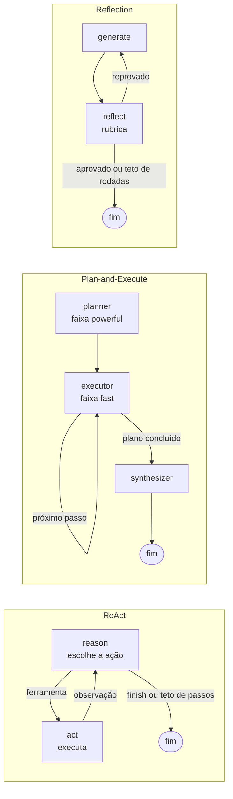

# Lab 04 · Agent Architectures

## Objetivo Técnico

Implementar com **LangGraph** os três padrões de agente mais usados, cada um em um arquivo e no mesmo formato (estado, nós, arestas), para comparar custo, latência e comportamento:

- **ReAct**: o modelo decide o próximo passo a cada volta, alternando raciocínio e uso de ferramenta;
- **Plan-and-Execute**: um modelo forte planeja uma vez e um modelo barato executa cada passo;
- **Reflection**: um nó escreve, outro critica contra uma rubrica, e o texto volta até passar.

O LangGraph cuida do fluxo: estado, laços e limites. As chamadas ao modelo passam por `@labs/shared-llm`, então fallback, validação com Zod e métricas valem dentro dos grafos. A ação do agente é um objeto validado por schema, não um texto para extrair com regex.

## Arquitetura e Fluxo



| Arquivo | Papel |
| --- | --- |
| `src/react.ts` | O grafo ReAct |
| `src/plan-execute.ts` | O grafo Plan-and-Execute |
| `src/reflection.ts` | O grafo Reflection |
| `src/tools.ts` | As ferramentas do ReAct |
| `src/prompts.ts` | Os prompts dos três padrões |
| `src/mock.ts` | Roteiro do provedor mock |

## Como Executar

```bash
# Os três padrões, com a tabela comparativa no fim
pnpm --filter @labs/04-agent-architectures dev

# Um padrão só: react, plan ou reflection
pnpm --filter @labs/04-agent-architectures dev react
```

Não precisa de Docker. Sem chave no `.env`, o provedor mock segue um roteiro que mostra o formato esperado de cada nó; as ferramentas rodam de verdade.

## Trade-offs e Métricas Observadas

- **ReAct** reage ao que descobre no caminho, mas chama o modelo a cada passo e reenvia o histórico inteiro: os tokens de entrada crescem a cada volta.
- **Plan-and-Execute** usa o modelo caro uma vez, e o plano pode ser auditado antes de rodar. Em troca, o plano não muda com o que os passos descobrem, a não ser que exista um nó de replanejamento.
- **Reflection** troca custo e latência por qualidade: cada rodada são duas chamadas a mais. Só converge com uma rubrica; "melhore o texto" não dá ao crítico um critério de parada.
- **Teto em código.** Nos três, o limite de passos ou de rodadas fica no grafo. Sem ele, um modelo que insiste na mesma ação gasta até o limite de recursão.
- **Ação estruturada contra tool calling nativo.** O schema plano funciona em qualquer provedor com JSON Schema, e é fácil de testar. O tool calling nativo permite chamadas em paralelo, e depende do suporte do modelo.

Preencha com a saída de `dev` usando um provedor real.

| Padrão | Chamadas ao LLM | Tokens in/out | Latência total (ms) | Custo estimado (USD) | Resultado correto? |
| --- | --- | --- | --- | --- | --- |
| ReAct | — | — | — | — | — |
| Plan-and-Execute | — | — | — | — | — |
| Reflection | — | — | — | — | — |

Modelos por faixa: `fast` — · `balanced` — · `powerful` —
