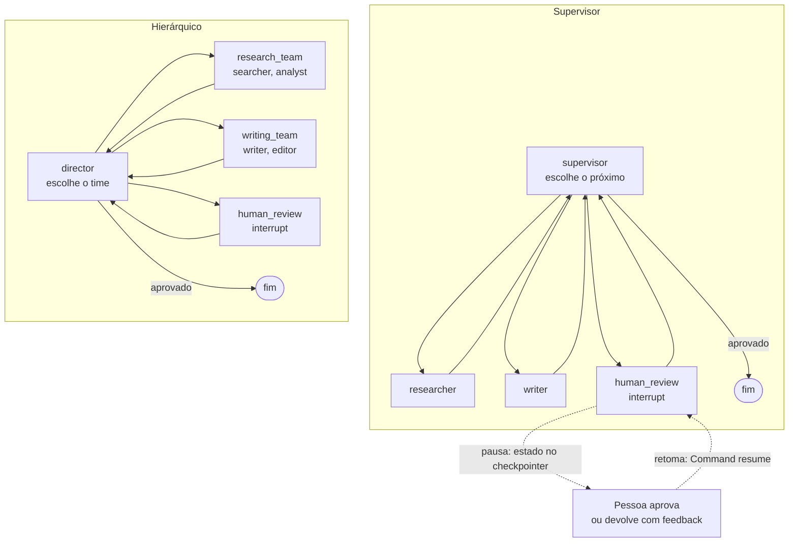

# Lab 05 · Multi-Agent Systems

## Objetivo Técnico

Orquestrar agentes especializados com **LangGraph** em duas topologias, com **Human-in-the-Loop** obrigatório nas duas:

- **Supervisor**: um coordenador decide, a cada volta, qual especialista age. Os especialistas não se falam: tudo passa pelo estado compartilhado;
- **Hierárquico**: o coordenador fala com times, e cada time é um grafo próprio, com estado próprio, que devolve só o resultado.

Nos dois, o trabalho só termina quando uma pessoa aprova o rascunho. O coordenador não tem "encerrar" entre as opções: o guardrail vale por construção, não por instrução no prompt. A pausa usa `interrupt()`, um checkpointer que guarda o estado e `Command({ resume })` para retomar, e a resposta da pessoa passa por schema Zod como qualquer entrada externa.

## Arquitetura e Fluxo



| Arquivo | Papel |
| --- | --- |
| `src/supervisor.ts` | O estado da equipe, o nó coordenador e o grafo Supervisor |
| `src/hierarchical.ts` | Os times como subgrafos e o grafo do diretor |
| `src/hitl.ts` | A pausa, os revisores e o laço de retomada |
| `src/prompts.ts` | Os prompts de cada papel |
| `src/mock.ts` | Roteiro do provedor mock |

## Como Executar

```bash
# Os dois padrões, com a tabela comparativa no fim
pnpm --filter @labs/05-multi-agent-systems dev

# Um padrão só: supervisor ou hierarchical
pnpm --filter @labs/05-multi-agent-systems dev supervisor

# Sem perguntar no terminal: revisor roteirizado, que reprova a 1ª versão e aprova a 2ª
HITL_AUTO=1 pnpm --filter @labs/05-multi-agent-systems dev
```

Em um terminal, o laboratório mostra o rascunho e pergunta: Enter aprova, qualquer texto reprova e vira o feedback para a reescrita. Fora de um terminal (CI), usa o revisor roteirizado. Não precisa de Docker.

## Trade-offs e Métricas Observadas

- **Supervisor contra hierárquico.** O supervisor é mais simples e gasta menos chamadas. O hierárquico esconde os passos internos de cada time e escala para mais especialistas, ao custo de mais chamadas e de um adaptador de estado por time.
- **Roteamento por LLM contra ordem fixa.** O coordenador gasta uma chamada por decisão. Quando a ordem é sempre a mesma, uma aresta fixa faz o mesmo trabalho sem custo; o LLM só se paga onde há decisão de verdade.
- **Aprovação humana.** Garante que nada sai sem revisão, e coloca uma pessoa no caminho crítico: a latência passa a ser a dela. Em produção a pausa dura horas, o que exige checkpointer persistente e retomada em outro processo.
- **Estado compartilhado contra estado por time.** Compartilhar é direto, mas todo agente enxerga tudo, e um subgrafo com os mesmos campos devolve o histórico em dobro para os reducers. Estado próprio isola e exige tradução na fronteira.
- **Teto de decisões.** Sem ele, dois agentes podem devolver o trabalho um ao outro sem fim.

Preencha com a saída de `dev` usando um provedor real.

| Padrão | Decisões do coordenador | Chamadas ao LLM | Tokens in/out | Custo estimado (USD) | Rodadas de revisão humana |
| --- | --- | --- | --- | --- | --- |
| Supervisor | — | — | — | — | — |
| Hierárquico | — | — | — | — | — |

Modelos por faixa: `fast` — · `balanced` —
