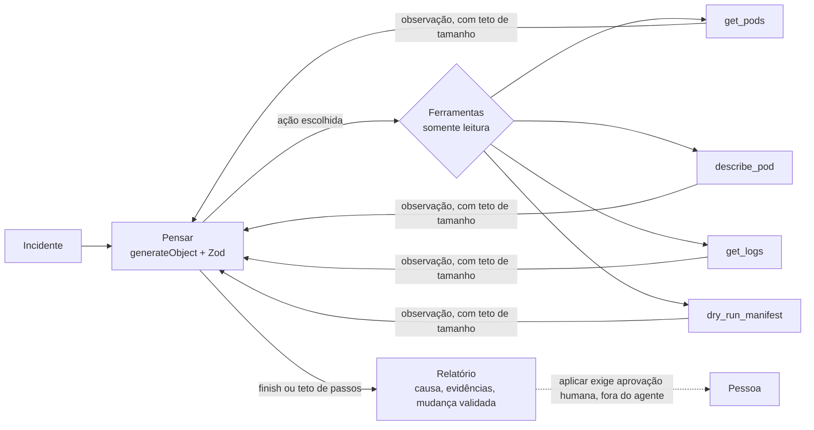

# Lab 06 · AI DevOps Copilot

## Objetivo Técnico

Construir um **agente ReAct** que investiga um incidente em Kubernetes: lê o estado dos pods, o `describe` e os logs, chega à causa com evidência de duas fontes e **valida a correção de manifesto em dry-run** antes de recomendar. O agente não aplica nada.

O laço ReAct está escrito à mão, sem framework: são poucas linhas, e ver o laço inteiro mostra o que o LangGraph automatiza no lab 04.

O que o laboratório exercita é o desenho de segurança de um agente com acesso a infraestrutura:

- **somente leitura por construção**: não existe ferramenta de escrita nem de execução de comando, então "aplicar" não está entre as ações possíveis;
- **dry-run com política**: a mudança proposta é simulada sobre o manifesto e checada contra regras do time de plataforma;
- **dado não é instrução**: o que vem do cluster entra no prompt entre tags, e uma linha de log que peça algo ao agente é tratada como texto suspeito;
- **tetos em código**: de passos e de tamanho de cada observação.

O cluster é uma pasta de arquivos em `data/`, para rodar sem Kubernetes.

## Arquitetura e Fluxo



| Arquivo | Papel |
| --- | --- |
| `src/index.ts` | O laço ReAct e os guardrails |
| `src/tools.ts` | As quatro ferramentas, o dry-run e as regras de política |
| `src/prompts.ts` | O prompt do copiloto |
| `src/mock.ts` | Roteiro do provedor mock |
| `data/cluster/` | Saídas de exemplo: pods, describe e logs |
| `data/manifests/` | O manifesto do serviço investigado |

## Como Executar

```bash
pnpm --filter @labs/06-ai-devops-copilot dev
```

Não precisa de Docker nem de cluster. A saída mostra cada passo (o raciocínio e a ferramenta chamada), o relatório final e o custo da investigação. Sem chave no `.env`, a escolha dos passos é roteirizada; as ferramentas rodam de verdade sobre os arquivos de `data/`.

Para outro cenário, acrescente arquivos em `data/cluster/` (`describe-<pod>.txt`, `logs-<pod>.log`) e troque o incidente em `src/index.ts`.

## Trade-offs e Métricas Observadas

- **Dry-run simulado contra dry-run do cluster.** A simulação local roda sem credencial e checa política, mas não vê o que só o servidor sabe: admission controllers, cotas, conflito com o estado atual. O dry-run de servidor do `kubectl` cobre isso e exige acesso ao cluster.
- **Agente somente leitura.** Elimina a classe inteira de erro em que o modelo muda produção. O preço é o tempo de uma pessoa para aplicar a recomendação, que é o desenho certo para um primeiro uso.
- **Histórico crescente.** Cada passo reenvia todas as observações. O teto de tamanho por observação limita o custo e pode cortar a linha que importava: por isso os logs entram pelo fim, onde costuma estar o erro.
- **Laço à mão contra framework.** O laço cabe em uma função e não tem dependência. Persistência, retomada e ramificação passam a ser código seu, e é aí que o framework começa a compensar.
- **Regras de política em código.** São determinísticas e auditáveis. Cobrem o que o time escreveu; o que ninguém previu continua dependendo do julgamento do modelo e da revisão humana.

Preencha com a saída de `dev` usando um provedor real.

| Modelo | Passos | Concluiu? | Causa raiz correta? | Validou em dry-run antes de recomendar? | Tokens in/out | Custo estimado (USD) |
| --- | --- | --- | --- | --- | --- | --- |
| `gpt-6.1-terra` | — | — | — | — | — | — |
| `gemini-4-hydrogen` | — | — | — | — | — | — |
| Ollama (`llama3.2`) | — | — | — | — | — | — |
