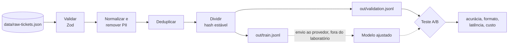

# Lab 07 · Fine-Tuning Datasets

## Objetivo Técnico

Preparar um dataset de fine-tuning do jeito que ele precisa chegar ao provedor, e deixar pronta a comparação que decide se o treino valeu:

1. **Limpeza**: validar cada registro com Zod, normalizar, remover dado pessoal (e-mail, CPF, telefone), deduplicar, e contar o que saiu por motivo;
2. **Divisão estável** entre treino e validação, pelo hash do texto: um exemplo nunca muda de lado entre execuções;
3. **JSONL no formato de chat**, relido do disco e validado linha a linha;
4. **Teste A/B** de dois modelos no mesmo conjunto de validação: acurácia, respostas fora do formato, latência e custo.

A tarefa é a classificação de tickets do lab 01. A pergunta que o laboratório prepara é: um modelo pequeno ajustado alcança o modelo maior, custando menos?

O laboratório **não dispara o treino**: isso custa dinheiro e depende do provedor.

## Arquitetura e Fluxo



| Arquivo | Papel |
| --- | --- |
| `src/clean.ts` | Funções puras: limpeza, PII, deduplicação, divisão, JSONL |
| `src/clean.test.ts` | Testes dessas funções |
| `src/index.ts` | O pipeline e o teste A/B |
| `src/prompts.ts` | O prompt do classificador, igual no treino e na avaliação |
| `data/raw-tickets.json` | Dado bruto de exemplo, com ruído de propósito |

## Como Executar

```bash
# Pipeline completo: limpa, grava os JSONL em out/ e roda o teste A/B
pnpm --filter @labs/07-fine-tuning-datasets dev

# Testes das funções de limpeza
pnpm --filter @labs/07-fine-tuning-datasets test
```

Não precisa de Docker. Sem chave no `.env`, os dois braços do A/B usam o mesmo roteiro do provedor mock e dão o mesmo resultado: o mock mostra o fluxo, não compara modelos.

Depois do treino, aponte um braço para o modelo ajustado:

```bash
AB_MODEL_A=<modelo base> AB_MODEL_B=<id do modelo ajustado> pnpm --filter @labs/07-fine-tuning-datasets dev
```

Com modelo explícito, o laboratório usa o primeiro provedor de `LLM_PROVIDERS`, sem fallback. O envio dos arquivos e a criação do job seguem a documentação de fine-tuning do provedor; `out/train.jsonl` e `out/validation.jsonl` já estão no formato de chat.

## Trade-offs e Métricas Observadas

- **Fine-tuning contra prompt melhor.** O treino só compensa depois que prompt e exemplos no contexto bateram no teto. Ele troca custo por requisição (prompt mais curto, modelo menor) por custo fixo de dado, treino e reavaliação a cada modelo base novo.
- **Remoção de PII por regex.** É barata e previsível, e deixa passar nome, endereço e formato fora do padrão. Dado real pede um detector dedicado e amostra revisada por gente antes do envio.
- **Deduplicação quase exata.** Ignorar caixa, acento e pontuação pega a cópia óbvia. Paráfrase escapa e pode cair nos dois lados da divisão, o que infla a acurácia de validação.
- **Resposta em texto livre.** O modelo ajustado aprende a responder só com o rótulo, então os dois braços são medidos assim, e a resposta fora do formato vira métrica própria.
- **Validação pequena.** Com poucos exemplos, um acerto muda a acurácia em vários pontos. Decidir entre modelos pede centenas de exemplos e intervalo de confiança.

Preencha com a saída de `dev` usando um provedor real.

| Braço | Modelo | Acurácia | Fora do formato | Latência média (ms) | Custo estimado (USD) |
| --- | --- | --- | --- | --- | --- |
| A: base, faixa `fast` | — | — | — | — | — |
| B: base, faixa `balanced` | — | — | — | — | — |
| B: modelo ajustado | — | — | — | — | — |

Exemplos de validação: — · Exemplos de treino: —
