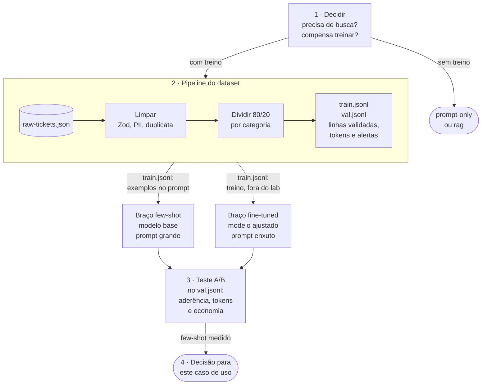

# Lab 07 · Fine-Tuning Datasets

## Objetivo Técnico

Responder, com código, às três perguntas que vêm antes de um fine-tuning:

1. **Vale treinar?** Um Decision Framework, `evaluateApproach(scenario)`, recebe cinco critérios do caso de uso e recomenda `prompt-only`, `rag`, `fine-tuning` ou `rag-plus-fine-tuning`, com a justificativa e os trade-offs. Entrada e saída são validadas com Zod.
2. **O dataset está pronto?** Um pipeline limpa o dado bruto (Zod, remoção de e-mail, CPF e telefone, deduplicação), divide em `train.jsonl` (80%) e `val.jsonl` (20%), valida cada linha no formato de chat e reporta os tokens estimados e os alertas de qualidade.
3. **O treino se pagaria?** Um teste A/B compara o modelo base com few-shot pesado contra o modelo ajustado com prompt enxuto: aderência ao schema, tokens por requisição e economia projetada em 100.000 requisições.

A tarefa é a triagem de tickets de suporte com saída em schema rígido: `{"category":"billing","priority":"P2"}`, e nada além disso.

O laboratório **não dispara o treino**: custa dinheiro e depende do provedor. Sem modelo ajustado, o braço `fine-tuned` do A/B é simulado.

## Arquitetura e Fluxo



Os números são os quatro passos de `src/index.ts`. O passo 4 roda o Decision Framework de novo, agora com o tamanho de few-shot que o A/B mediu.

### Matriz de decisão

O motor separa a pergunta em dois eixos. Cada um tem a sua resposta, e uma não substitui a outra: busca não ensina formato, e treino não ensina fato de forma confiável.

| | Prompt-only | RAG | Fine-tuning |
| --- | --- | --- | --- |
| Resolve | Tarefa que instrução e poucos exemplos dão conta | Conhecimento: fato que muda ou que precisa de fonte | Comportamento: formato e estilo |
| Dado muda toda semana ou todo dia | Só se couber no prompt e alguém atualizar | Sim: basta reindexar | Não: cada mudança seria um retreino |
| Resposta precisa citar a fonte | Não | Sim: devolve o trecho junto | Não: peso de modelo não cita documento |
| Formato ou estilo difícil | Com few-shot, pago em toda requisição | Não resolve | Sim: o formato vai para os pesos |
| Few-shot pesado (≥ 1.000 tokens) | Custo e latência em toda requisição | Não muda | Prompt enxuto |
| Meta apertada de latência e custo | Piora com o tamanho do prompt | Soma uma busca por pergunta | Melhora: menos tokens por requisição |
| Custo fixo | Nenhum | Pipeline de dados e avaliação da busca | Dataset, treino e reavaliação a cada modelo base |

As regras de `evaluateApproach`:

- **Busca** entra quando a resposta exige fonte **ou** o dado muda toda semana ou todo dia.
- **Treino** entra quando o few-shot já pesa (≥ 1.000 tokens) **e** há pressão para tirá-lo do prompt: formato difícil, meta apertada, ou os dois em grau médio.
- Nenhum dos dois dá `prompt-only`. Os dois dão `rag-plus-fine-tuning`.

O que o motor devolve para um caso de cada abordagem, e para este laboratório:

| Caso | Dado muda | Exige fonte | Formato | Few-shot (tokens) | Meta | Recomendação |
| --- | --- | --- | --- | --- | --- | --- |
| FAQ de produto | `static` | não | `low` | 200 | `relaxed` | `prompt-only` |
| Perguntas sobre o manual interno | `weekly` | sim | `low` | 300 | `moderate` | `rag` |
| Extração de contrato em JSON | `static` | não | `high` | 3.000 | `moderate` | `fine-tuning` |
| Resposta com política, no tom da marca | `weekly` | sim | `high` | 2.500 | `strict` | `rag-plus-fine-tuning` |
| Triagem de tickets (este lab) | `static` | não | `medium` | 1.248, medido no A/B | `strict` | `fine-tuning` |

| Arquivo | Papel |
| --- | --- |
| `src/decision-framework.ts` | O motor de decisão e os casos de referência |
| `src/dataset-builder.ts` | O pipeline: divisão, JSONL, validação, tokens e alertas |
| `src/ab-eval.ts` | O teste A/B e a projeção de economia |
| `src/clean.ts` | Limpeza do dado bruto: validação, PII, deduplicação |
| `src/schema.ts` | O schema rígido da triagem e a régua de aderência |
| `src/prompts.ts` | O prompt enxuto e o prompt few-shot |
| `src/mock.ts` | Roteiro do provedor mock |
| `src/index.ts` | Roda os quatro passos |
| `data/raw-tickets.json` | Dado bruto de exemplo, com ruído de propósito |

## Como Executar

```bash
# Os quatro passos. Grava out/train.jsonl e out/val.jsonl
pnpm --filter @labs/07-fine-tuning-datasets dev

# Testes: decision framework, pipeline do dataset e a conta do A/B
pnpm --filter @labs/07-fine-tuning-datasets test
```

Não precisa de Docker nem de chave: sem chave no `.env`, tudo roda com o provedor mock. Se o dataset tiver alerta de nível `ERRO`, o `dev` termina com código 1.

Cada linha dos JSONL é uma conversa completa, e a resposta do assistant é o JSON da triagem:

```json
{"messages":[{"role":"system","content":"Você faz a triagem de tickets de suporte. ..."},{"role":"user","content":"<ticket>\nComo altero o e-mail de login da minha conta?\n</ticket>"},{"role":"assistant","content":"{\"category\":\"access\",\"priority\":\"P3\"}"}]}
```

Com um provedor real, o A/B tem dois momentos:

```bash
# Antes do treino: o braço fine-tuned é o modelo base com o prompt enxuto
pnpm --filter @labs/07-fine-tuning-datasets dev

# Depois do treino: aponte o braço para o modelo ajustado
AB_FINE_TUNED_MODEL=<id do modelo ajustado> pnpm --filter @labs/07-fine-tuning-datasets dev
```

`AB_BASE_MODEL=<id>` troca o modelo base dos dois braços. Com modelo explícito, o laboratório usa o primeiro provedor de `LLM_PROVIDERS`, sem fallback. A projeção supõe que o modelo ajustado saiu do mesmo modelo base do braço few-shot.

**Onde treinar.** O envio dos arquivos e a criação do job seguem a documentação do provedor escolhido. Confira antes se o serviço ainda existe: a OpenAI está encerrando a plataforma de fine-tuning dela. Segundo o [guia de fine-tuning](https://developers.openai.com/api/docs/guides/supervised-fine-tuning), consultado em 19/11/2026, ela não aceita mais usuários novos, clientes existentes criam jobs até 06/01/2027, e os modelos ajustados seguem disponíveis para inferência até o modelo base ser desligado.

## Trade-offs e Métricas Observadas

- **Fine-tuning contra prompt melhor.** O treino só compensa depois que prompt e exemplos no contexto bateram no teto. Ele troca custo por requisição por custo fixo de dado, treino e reavaliação a cada modelo base novo.
- **Treino gerenciado pode acabar.** O modelo ajustado fica preso ao modelo base e ao provedor. O aviso da OpenAI, acima, é o exemplo: quem treinou lá tem data para refazer o trabalho em outro lugar.
- **Economia pequena em modelo barato.** Na simulação abaixo, 100 mil requisições economizam cerca de US$ 11, porque o modelo base custa US$ 0,10 por milhão de tokens. O treino se paga com volume alto ou com modelo base mais caro.
- **Cache de prompt encolhe a economia.** O bloco de exemplos do few-shot é fixo, e é exatamente o que o cache de prompt barateia, onde o provedor oferece. A projeção usa preço cheio de tabela, como todo o monorepo.
- **Custo fixo fora da projeção.** Curadoria do dataset, treino e reavaliação não entram na conta. Também não entra a nova tentativa que uma resposta fora do schema custa.
- **Aderência estrita.** A resposta inteira tem que ser o JSON do schema; bloco de código em volta ou chave a mais conta como falha. O A/B usa `generateText` de propósito: `generateObject` pede o formato ao provedor e ainda tenta corrigir, o que esconderia a falha que o teste conta.
- **Divisão refeita a cada versão.** Cada categoria cede 20% para a validação, e a mesma entrada dá sempre a mesma divisão. Quando o dataset cresce, um exemplo pode trocar de lado. Para comparar modelos entre versões, decida pelo valor do hash de cada exemplo.
- **Tokens estimados.** A conta é de ~4 caracteres por token. Serve para comparar os dois braços; para orçamento de treino, use o tokenizador do provedor.
- **Remoção de PII por regex.** É barata e previsível, e deixa passar nome, endereço e formato fora do padrão. Dado real pede um detector dedicado e amostra revisada por gente antes do envio.
- **Deduplicação quase exata.** Ignorar caixa, acento e pontuação pega a cópia óbvia. Paráfrase escapa e pode cair nos dois lados da divisão, o que infla o resultado da validação.
- **Validação pequena.** Com 8 exemplos, um acerto muda a taxa em 12,5 pontos. Decidir entre modelos pede centenas de exemplos e intervalo de confiança.
- **Limite do motor de decisão.** São cinco critérios e cortes fixos. Ele não olha o tamanho da base de conhecimento, a sensibilidade do dado nem a capacidade do time de manter um ciclo de treino.

### Dataset de exemplo

Execução de 19/11/2026. De 48 registros brutos, 40 foram aproveitados: saíram 2 inválidos, 2 com rótulo desconhecido, 2 curtos demais e 2 duplicados.

| Arquivo | Exemplos | % do total | Tokens estimados | billing | outage | access | question |
| --- | --- | --- | --- | --- | --- | --- | --- |
| `train.jsonl` | 32 | 80% | 2.044 | 8 | 8 | 8 | 8 |
| `val.jsonl` | 8 | 20% | 508 | 2 | 2 | 2 | 2 |

Um alerta: treino com 32 exemplos, abaixo dos 50 recomendados. Os limites (mínimo de 10, recomendado de 50) são os do guia de fine-tuning da OpenAI, consultado em 19/11/2026.

### Simulação do A/B em modo mock

Execução de 19/11/2026, sem chave de API, nos 8 tickets de validação.

| Braço | Aderência ao schema | Tokens in/out por requisição |
| --- | --- | --- |
| `few-shot`: modelo base, 32 exemplos no prompt | 7 de 8 (roteiro) | 1.248 / 10 |
| `fine-tuned`: modelo ajustado simulado, prompt enxuto | 8 de 8 (roteiro) | 54 / 10 |

Projeção para 100.000 requisições:

| Braço | USD por milhão de tokens (in/out) | USD por requisição | USD em 100.000 requisições |
| --- | --- | --- | --- |
| `few-shot` | 0,10 / 0,50 | 0,000130 | 12,99 |
| `fine-tuned` | 0,20 / 1,00 | 0,000021 | 2,07 |

Economia projetada: **US$ 10,92 (84%)**.

O que é medido e o que é premissa nesta simulação:

- **Tokens** saem do tamanho real dos dois prompts, na estimativa de ~4 caracteres por token. O few-shot gasta 23 vezes mais tokens de entrada: 1.248 contra 54.
- **Aderência** é roteiro do mock. O braço `few-shot` foi roteirizado para embrulhar o JSON em bloco de código em 1 a cada 8 respostas, só para a métrica aparecer na tabela. Não é evidência de que modelo base erra nessa proporção.
- **Preço do modelo base** é o de tabela de `@labs/shared-llm` para `gpt-6-luna`.
- **Preço do modelo ajustado** é 2× o do base. É a proporção da [tabela de preços da OpenAI](https://developers.openai.com/api/docs/pricing) para modelos pequenos (`gpt-4.1-mini`, `gpt-4o-mini`), consultada em 19/11/2026. Nos modelos grandes a proporção é 1,5×.

### A/B com provedor real

Preencha com a saída de `dev`.

| Braço | Modelo | Aderência ao schema | Acerto | Tokens in/out por requisição | Latência média (ms) | USD em 100.000 requisições |
| --- | --- | --- | --- | --- | --- | --- |
| `few-shot` | — | — | — | — | — | — |
| `fine-tuned`, antes do treino (modelo base, prompt enxuto) | — | — | — | — | — | — |
| `fine-tuned`, modelo ajustado | — | — | — | — | — | — |
