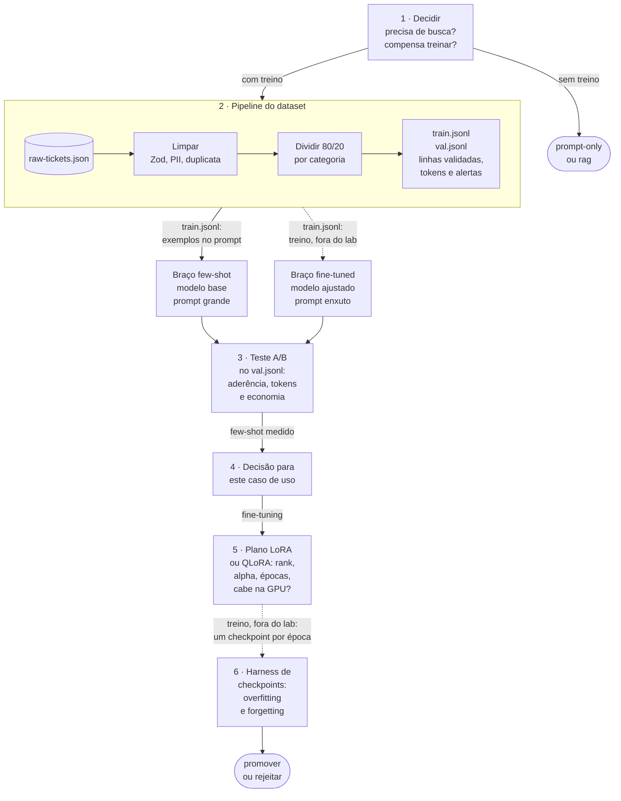

# Lab 07 · Fine-Tuning Datasets

## Objetivo Técnico

Responder, com código, às cinco perguntas de um fine-tuning: três antes do treino, uma sobre o plano dele e uma depois.

1. **Vale treinar?** Um Decision Framework, `evaluateApproach(scenario)`, recebe cinco critérios do caso de uso e recomenda `prompt-only`, `rag`, `fine-tuning` ou `rag-plus-fine-tuning`, com a justificativa e os trade-offs. Entrada e saída são validadas com Zod.
2. **O dataset está pronto?** Um pipeline limpa o dado bruto (Zod, remoção de e-mail, CPF e telefone, deduplicação), divide em `train.jsonl` (80%) e `val.jsonl` (20%), valida cada linha no formato de chat e reporta os tokens estimados e os alertas de qualidade.
3. **O treino se pagaria?** Um teste A/B compara o modelo base com few-shot pesado contra o modelo ajustado com prompt enxuto: aderência ao schema, tokens por requisição e economia projetada em 100.000 requisições.
4. **O treino cabe na GPU?** `buildLoraTrainingPlan(params)` escolhe rank, alpha, learning rate e épocas, estima os parâmetros treináveis e a VRAM de LoRA (16-bit) e de QLoRA (4-bit), e recomenda o método que cabe no hardware. Entrada e saída são validadas com Zod.
5. **Qual checkpoint vai para produção?** `evaluateTrainingCheckpoints(checkpoints)` recebe as métricas de cada época, aponta onde o overfitting começa, bloqueia catastrophic forgetting e escolhe o checkpoint, ou recomenda rejeitar o treino.

A tarefa é a triagem de tickets de suporte com saída em schema rígido: `{"category":"billing","priority":"P2"}`, e nada além disso.

O laboratório **não dispara o treino**: custa dinheiro e depende do provedor ou de uma GPU. Sem modelo ajustado, o braço `fine-tuned` do A/B é simulado, e as métricas de checkpoint são um roteiro.

## Arquitetura e Fluxo



Os números são os seis passos de `src/index.ts`. O passo 4 roda o Decision Framework de novo, agora com o tamanho de few-shot que o A/B mediu. Entre o passo 5 e o 6 fica o treino, que o laboratório não roda.

### Matriz de decisão

O motor separa a pergunta em dois eixos. Cada um tem a sua resposta, e uma não substitui a outra: busca não ensina formato, e treino não ensina fato de forma confiável.

| | Prompt-only | RAG | Fine-tuning |
| --- | --- | --- | --- |
| Resolve | Tarefa que instrução e poucos exemplos dão conta | Conhecimento: fato que muda ou que precisa de fonte | Comportamento: formato e estilo |
| Dado muda toda semana ou todo dia | Só se couber no prompt e alguém atualizar | Sim: basta reindexar | Não: cada mudança seria um retreino |
| Resposta precisa citar a fonte | Não | Sim: devolve o trecho junto | Não: peso de modelo não cita documento |
| Formato ou estilo difícil | Com few-shot, pago em toda requisição | Não resolve | Sim: o formato vai para os pesos |
| Few-shot pesado (≥ 1.000 tokens) | Custo e latência em toda requisição | Não muda | Prompt enxuto |
| Meta apertada de latência e custo | Piora com o tamanho do prompt | Soma uma busca por pergunta | Melhora: menos tokens por requisição |
| Custo fixo | Nenhum | Pipeline de dados e avaliação da busca | Dataset, treino e reavaliação a cada modelo base |

As regras de `evaluateApproach`:

- **Busca** entra quando a resposta exige fonte **ou** o dado muda toda semana ou todo dia.
- **Treino** entra quando o few-shot já pesa (≥ 1.000 tokens) **e** há pressão para tirá-lo do prompt: formato difícil, meta apertada, ou os dois em grau médio.
- Nenhum dos dois dá `prompt-only`. Os dois dão `rag-plus-fine-tuning`.

O que o motor devolve para um caso de cada abordagem, e para este laboratório:

| Caso | Dado muda | Exige fonte | Formato | Few-shot (tokens) | Meta | Recomendação |
| --- | --- | --- | --- | --- | --- | --- |
| FAQ de produto | `static` | não | `low` | 200 | `relaxed` | `prompt-only` |
| Perguntas sobre o manual interno | `weekly` | sim | `low` | 300 | `moderate` | `rag` |
| Extração de contrato em JSON | `static` | não | `high` | 3.000 | `moderate` | `fine-tuning` |
| Resposta com política, no tom da marca | `weekly` | sim | `high` | 2.500 | `strict` | `rag-plus-fine-tuning` |
| Triagem de tickets (este lab) | `static` | não | `medium` | 1.248, medido no A/B | `strict` | `fine-tuning` |

| Arquivo | Papel |
| --- | --- |
| `src/decision-framework.ts` | O motor de decisão e os casos de referência |
| `src/dataset-builder.ts` | O pipeline: divisão, JSONL, validação, tokens e alertas |
| `src/ab-eval.ts` | O teste A/B e a projeção de economia |
| `src/lora-config.ts` | O plano de treino: hiperparâmetros, parâmetros treináveis, VRAM e método |
| `src/model-eval-harness.ts` | O harness: overfitting, catastrophic forgetting e a escolha do checkpoint |
| `src/clean.ts` | Limpeza do dado bruto: validação, PII, deduplicação |
| `src/schema.ts` | O schema rígido da triagem e a régua de aderência |
| `src/prompts.ts` | O prompt enxuto e o prompt few-shot |
| `src/mock.ts` | Roteiro do provedor mock |
| `src/index.ts` | Roda os seis passos |
| `data/raw-tickets.json` | Dado bruto de exemplo, com ruído de propósito |
| `data/simulated-checkpoints.json` | Métricas de checkpoint de exemplo: um roteiro, não um treino |

## Como Executar

```bash
# Os seis passos. Grava out/train.jsonl e out/val.jsonl
pnpm --filter @labs/07-fine-tuning-datasets dev

# Testes: decision framework, dataset, A/B, plano LoRA e harness de checkpoints
pnpm --filter @labs/07-fine-tuning-datasets test
```

Não precisa de Docker nem de chave: sem chave no `.env`, tudo roda com o provedor mock. O `dev` termina com código 1 em dois casos: o dataset tem alerta de nível `ERRO`, ou o harness rejeita o treino.

Cada linha dos JSONL é uma conversa completa, e a resposta do assistant é o JSON da triagem:

```json
{"messages":[{"role":"system","content":"Você faz a triagem de tickets de suporte. ..."},{"role":"user","content":"<ticket>\nComo altero o e-mail de login da minha conta?\n</ticket>"},{"role":"assistant","content":"{\"category\":\"access\",\"priority\":\"P3\"}"}]}
```

Com um provedor real, o A/B tem dois momentos:

```bash
# Antes do treino: o braço fine-tuned é o modelo base com o prompt enxuto
pnpm --filter @labs/07-fine-tuning-datasets dev

# Depois do treino: aponte o braço para o modelo ajustado
AB_FINE_TUNED_MODEL=<id do modelo ajustado> pnpm --filter @labs/07-fine-tuning-datasets dev
```

`AB_BASE_MODEL=<id>` troca o modelo base dos dois braços. Com modelo explícito, o laboratório usa o primeiro provedor de `LLM_PROVIDERS`, sem fallback. A projeção supõe que o modelo ajustado saiu do mesmo modelo base do braço few-shot.

**Onde treinar.** O envio dos arquivos e a criação do job seguem a documentação do provedor escolhido. Confira antes se o serviço ainda existe: a OpenAI está encerrando a plataforma de fine-tuning dela. Segundo o [guia de fine-tuning](https://developers.openai.com/api/docs/guides/supervised-fine-tuning), consultado em 19/11/2026, ela não aceita mais usuários novos, clientes existentes criam jobs até 06/01/2027, e os modelos ajustados seguem disponíveis para inferência até o modelo base ser desligado.

Em modelo aberto, o treino é LoRA ou QLoRA em GPU própria ou alugada. O passo 5 faz a conta do que cabe: troque em `src/index.ts` o tamanho do modelo base e as GPUs.

**Depois do treino.** Troque `data/simulated-checkpoints.json` pelas métricas do seu treino, uma linha por época, e rode o `dev` de novo:

```json
[
  { "epoch": 1, "trainLoss": 1.42, "valLoss": 1.38, "domainSchemaAccuracy": 0.71, "generalReasoningAccuracy": 0.81, "baselineGeneralAccuracy": 0.82 }
]
```

`domainSchemaAccuracy` é a aderência ao schema, a mesma métrica do A/B. `generalReasoningAccuracy` é a acurácia em uma suíte de raciocínio geral, fora do domínio do treino. `baselineGeneralAccuracy` é a mesma suíte medida no modelo base, e se repete em todas as linhas.

## Trade-offs e Métricas Observadas

- **Fine-tuning contra prompt melhor.** O treino só compensa depois que prompt e exemplos no contexto bateram no teto. Ele troca custo por requisição por custo fixo de dado, treino e reavaliação a cada modelo base novo.
- **Treino gerenciado pode acabar.** O modelo ajustado fica preso ao modelo base e ao provedor. O aviso da OpenAI, acima, é o exemplo: quem treinou lá tem data para refazer o trabalho em outro lugar.
- **Economia pequena em modelo barato.** Na simulação abaixo, 100 mil requisições economizam cerca de US$ 11, porque o modelo base custa US$ 0,10 por milhão de tokens. O treino se paga com volume alto ou com modelo base mais caro.
- **Cache de prompt encolhe a economia.** O bloco de exemplos do few-shot é fixo, e é exatamente o que o cache de prompt barateia, onde o provedor oferece. A projeção usa preço cheio de tabela, como todo o monorepo.
- **Custo fixo fora da projeção.** Curadoria do dataset, treino e reavaliação não entram na conta. Também não entra a nova tentativa que uma resposta fora do schema custa.
- **Aderência estrita.** A resposta inteira tem que ser o JSON do schema; bloco de código em volta ou chave a mais conta como falha. O A/B usa `generateText` de propósito: `generateObject` pede o formato ao provedor e ainda tenta corrigir, o que esconderia a falha que o teste conta.
- **Divisão refeita a cada versão.** Cada categoria cede 20% para a validação, e a mesma entrada dá sempre a mesma divisão. Quando o dataset cresce, um exemplo pode trocar de lado. Para comparar modelos entre versões, decida pelo valor do hash de cada exemplo.
- **Tokens estimados.** A conta é de ~4 caracteres por token. Serve para comparar os dois braços; para orçamento de treino, use o tokenizador do provedor.
- **Remoção de PII por regex.** É barata e previsível, e deixa passar nome, endereço e formato fora do padrão. Dado real pede um detector dedicado e amostra revisada por gente antes do envio.
- **Deduplicação quase exata.** Ignorar caixa, acento e pontuação pega a cópia óbvia. Paráfrase escapa e pode cair nos dois lados da divisão, o que infla o resultado da validação.
- **Validação pequena.** Com 8 exemplos, um acerto muda a taxa em 12,5 pontos. Decidir entre modelos pede centenas de exemplos e intervalo de confiança.
- **Limite do motor de decisão.** São cinco critérios e cortes fixos. Ele não olha o tamanho da base de conhecimento, a sensibilidade do dado nem a capacidade do time de manter um ciclo de treino.

### Dataset de exemplo

Execução de 19/11/2026. De 48 registros brutos, 40 foram aproveitados: saíram 2 inválidos, 2 com rótulo desconhecido, 2 curtos demais e 2 duplicados.

| Arquivo | Exemplos | % do total | Tokens estimados | billing | outage | access | question |
| --- | --- | --- | --- | --- | --- | --- | --- |
| `train.jsonl` | 32 | 80% | 2.044 | 8 | 8 | 8 | 8 |
| `val.jsonl` | 8 | 20% | 508 | 2 | 2 | 2 | 2 |

Um alerta: treino com 32 exemplos, abaixo dos 50 recomendados. Os limites (mínimo de 10, recomendado de 50) são os do guia de fine-tuning da OpenAI, consultado em 19/11/2026.

### Simulação do A/B em modo mock

Execução de 19/11/2026, sem chave de API, nos 8 tickets de validação.

| Braço | Aderência ao schema | Tokens in/out por requisição |
| --- | --- | --- |
| `few-shot`: modelo base, 32 exemplos no prompt | 7 de 8 (roteiro) | 1.248 / 10 |
| `fine-tuned`: modelo ajustado simulado, prompt enxuto | 8 de 8 (roteiro) | 54 / 10 |

Projeção para 100.000 requisições:

| Braço | USD por milhão de tokens (in/out) | USD por requisição | USD em 100.000 requisições |
| --- | --- | --- | --- |
| `few-shot` | 0,10 / 0,50 | 0,000130 | 12,99 |
| `fine-tuned` | 0,20 / 1,00 | 0,000021 | 2,07 |

Economia projetada: **US$ 10,92 (84%)**.

O que é medido e o que é premissa nesta simulação:

- **Tokens** saem do tamanho real dos dois prompts, na estimativa de ~4 caracteres por token. O few-shot gasta 23 vezes mais tokens de entrada: 1.248 contra 54.
- **Aderência** é roteiro do mock. O braço `few-shot` foi roteirizado para embrulhar o JSON em bloco de código em 1 a cada 8 respostas, só para a métrica aparecer na tabela. Não é evidência de que modelo base erra nessa proporção.
- **Preço do modelo base** é o de tabela de `@labs/shared-llm` para `gpt-6-luna`.
- **Preço do modelo ajustado** é 2× o do base. É a proporção da [tabela de preços da OpenAI](https://developers.openai.com/api/docs/pricing) para modelos pequenos (`gpt-4.1-mini`, `gpt-4o-mini`), consultada em 19/11/2026. Nos modelos grandes a proporção é 1,5×.

### A/B com provedor real

Preencha com a saída de `dev`.

| Braço | Modelo | Aderência ao schema | Acerto | Tokens in/out por requisição | Latência média (ms) | USD em 100.000 requisições |
| --- | --- | --- | --- | --- | --- | --- |
| `few-shot` | — | — | — | — | — | — |
| `fine-tuned`, antes do treino (modelo base, prompt enxuto) | — | — | — | — | — | — |
| `fine-tuned`, modelo ajustado | — | — | — | — | — | — |

### Plano de treino LoRA / QLoRA

LoRA congela os pesos do modelo base e treina, ao lado de cada matriz escolhida, duas matrizes pequenas de posto `r`. QLoRA é o mesmo adaptador sobre o modelo base carregado em 4 bits. As regras de `buildLoraTrainingPlan`:

| Saída | Regra |
| --- | --- |
| `r` | 8 para `format-style`, 32 para `domain-reasoning` |
| `loraAlpha` | `2 × r` |
| `learningRate` | `2e-4` com rank 8, `1e-4` com rank 32 |
| `epochs` | 4 com menos de 1.000 exemplos de treino, 3 com menos de 10.000, 2 daí em diante |
| Parâmetros treináveis | `0,0125% × r` dos parâmetros do modelo base: 0,1% com rank 8, 0,4% com rank 32 |
| VRAM de LoRA (16-bit) | `2,2 GB × bilhões de parâmetros do modelo base` |
| VRAM de QLoRA (4-bit) | `0,75 GB × bilhões de parâmetros do modelo base` |
| `recommendedMethod` | `LoRA (16-bit)` se a VRAM de LoRA cabe na GPU; senão `QLoRA (4-bit)` se a de QLoRA cabe; senão `Cloud/Multi-GPU Required` |
| Alerta de overfitting | Menos de 100 exemplos de treino |

De onde vêm as constantes:

- **2,2 GB por bilhão.** 16 bits são 2 bytes por parâmetro: 2,0 GB por bilhão. Os 0,2 restantes são folga.
- **0,75 GB por bilhão.** 4 bits são 0,5 GB por bilhão; o resto é folga. O [artigo do QLoRA](https://arxiv.org/abs/2305.14314) relata o ajuste de um modelo de 65 bilhões em uma GPU de 48 GB: 0,74 GB por bilhão.
- **0,0125% por unidade de rank.** Um adaptador soma `r × (entrada + saída)` parâmetros por matriz. Na arquitetura do Mistral 7B (largura 4096, 32 camadas, `k` e `v` com saída 1024, conforme o [`config.json` do zephyr-7b-beta](https://huggingface.co/HuggingFaceH4/zephyr-7b-beta/blob/main/config.json)), rank 8 nas quatro projeções de atenção soma 6.815.744 parâmetros: 0,09% dos 7,24 bilhões do modelo, arredondado para 0,1%.
- **Rank, learning rate, épocas e o corte de 100 exemplos** são regras de partida do laboratório, não medição.

Trade-offs do plano:

- **A VRAM estimada é piso.** A fórmula cobre os pesos carregados e uma folga. Ela não conta a memória de ativações e gradientes, que cresce com o batch e com o comprimento da sequência. Num [experimento público](https://magazine.sebastianraschka.com/p/practical-tips-for-finetuning-llms) com Llama 2 de 7 bilhões, o treino usou 21,33 GB em LoRA e 14,18 GB em QLoRA; a fórmula daria 15,4 GB e 5,25 GB. Uma GPU em que a conta fecha por pouco pode não aguentar o treino: rode um passo e meça antes de alugar.
- **LoRA contra QLoRA.** QLoRA cabe em GPU menor, e o preço é tempo: no mesmo experimento, 2,79 h contra 1,85 h de LoRA. Por isso o plano fica com LoRA quando ela cabe.
- **Rank maior não sai de graça.** De 8 para 32, os parâmetros treináveis quadruplicam. É capacidade para raciocínio de domínio, e também para decorar um dataset pequeno.
- **Alpha anda com o rank.** O [PEFT](https://huggingface.co/docs/peft/package_reference/lora) escala a atualização por `lora_alpha / r`. Com `alpha = 2r` o fator fica em 2 em qualquer rank. Com alpha fixo em 16, subir o rank de 8 para 32 derrubaria o fator de 2 para 0,5. O PEFT também oferece `use_rslora`, que escala por `lora_alpha / sqrt(r)`.
- **A fração treinável é aproximada.** Ela cai em modelo mais largo (é proporcional a `r / largura`) e sobe cerca de 3× se o adaptador entrar também nas camadas MLP. Com a arquitetura em mãos, faça a conta exata.

Execução de 19/11/2026: modelo base de 8 bilhões de parâmetros, os 32 exemplos do `train.jsonl`, tarefa `format-style`.

| `r` | `loraAlpha` | `learningRate` | `epochs` | Parâmetros treináveis |
| --- | --- | --- | --- | --- |
| 8 | 16 | 2e-4 | 4 | ~0,1% (~8 milhões) |

| GPU | VRAM de LoRA (16-bit) | VRAM de QLoRA (4-bit) | Recomendação |
| --- | --- | --- | --- |
| 16 GB | 17,6 GB | 6 GB | `QLoRA (4-bit)` |
| 24 GB | 17,6 GB | 6 GB | `LoRA (16-bit)` |

Um alerta: risco de overfitting, porque o treino tem 32 exemplos, menos de 100.

### Harness de checkpoints

Os critérios de `evaluateTrainingCheckpoints`:

| Critério | Regra | Efeito |
| --- | --- | --- |
| Início do overfitting | Primeira época em que o `valLoss` sobe em relação à anterior com o `trainLoss` ainda caindo | Alerta `AVISO` e `overfittingStartEpoch` |
| Overfitting leve | Depois do início, `valLoss` até 10% acima do melhor `valLoss` já visto | Passa no gate |
| Overfitting severo | `valLoss` mais de 10% acima do melhor `valLoss` já visto | Reprova o checkpoint |
| Catastrophic forgetting | `generalReasoningAccuracy` mais de 0,10 (10 pontos) abaixo de `baselineGeneralAccuracy` | Alerta `CRÍTICO` e reprova o checkpoint |
| Seleção | Maior `domainSchemaAccuracy` entre os que passam; no empate, o menor `valLoss`, depois a época mais antiga | `decision: "promote"` |
| Rejeição | Nenhum checkpoint passa | `decision: "reject"`, e o `dev` termina com código 1 |

`valLoss` subindo junto com o `trainLoss` não conta como overfitting: é treino instável. Um checkpoint que volta a ser o melhor `valLoss` sai da conta.

Limites do harness:

- **Gates fixos.** Os dois cortes, 10 pontos de raciocínio geral e 10% de `valLoss`, são ponto de partida. Calibre com a sua suíte e o seu risco.
- **Sem piso de acurácia de domínio.** Um treino ruim, mas sem overfitting severo e sem forgetting, tem um checkpoint promovido. Se o seu caso tem uma meta, como o resultado do braço few-shot no A/B, filtre antes de escolher.
- **O harness só compara números.** Ele não roda o modelo. A qualidade da suíte de raciocínio geral, e o tamanho dela, são de quem mede.
- **Overfitting leve passa.** O `valLoss` pode subir um pouco com a acurácia de domínio ainda subindo. Só o severo reprova; o leve aparece no relatório e na razão da escolha.

Roteiro de 19/11/2026, em `data/simulated-checkpoints.json`. O modelo base faz 82% na suíte de raciocínio geral.

| Época | `trainLoss` | `valLoss` | Overfitting | Acurácia de domínio | Raciocínio geral | Gate |
| --- | --- | --- | --- | --- | --- | --- |
| 1 | 1,42 | 1,38 | não | 71% | 81% | passa |
| 2 | 0,83 | 0,80 | não | 94% | 80% | passa, **escolhido** |
| 3 | 0,52 | 0,84 | leve (+5%) | 93% | 77% | passa |
| 4 | 0,30 | 0,96 | severo (+20%) | 89% | 68%, 14 pontos abaixo do base | reprovado |

O overfitting começa na época 3, a época 4 dispara o alerta crítico de catastrophic forgetting, e vai para produção a época 2. Os números são um roteiro, escrito para os três estados aparecerem na tabela: nenhum treino rodou.

### Treino real

Preencha depois de treinar.

| Modelo base | Método | GPU | VRAM medida | Tempo de treino | Checkpoint escolhido | Acurácia de domínio | Raciocínio geral × base |
| --- | --- | --- | --- | --- | --- | --- | --- |
| — | — | — | — | — | — | — | — |
