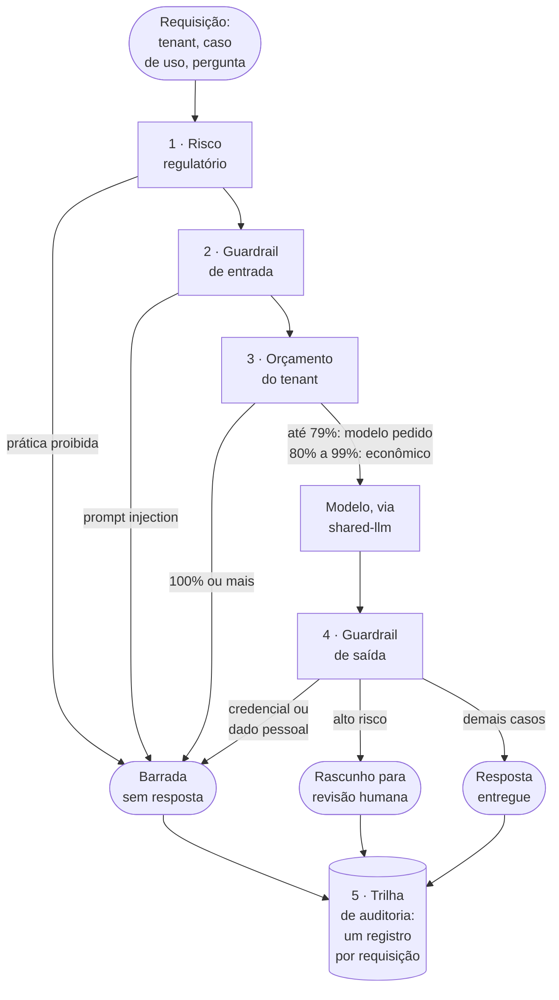

# Lab 08 · AI Governance & Guardrails

## Objetivo Técnico

Pôr em código as cinco travas que ficam em volta de uma chamada de LLM em produção. O prompt orienta o modelo; quem garante é o código.

1. **Guardrails de entrada e de saída** (`src/guardrails.ts`). `checkInput` barra tentativa de prompt injection e de jailbreak antes de qualquer chamada. `checkOutput` barra resposta com credencial (`sk-...`, token, chave privada) ou com dado pessoal sem máscara.
2. **Classificação de risco regulatório** (`src/risk-classifier.ts`). `classifyAiSystemRisk(useCase)` devolve `minimal-risk`, `limited-risk`, `high-risk` ou `unacceptable-risk`, com os requisitos de governança do nível e o motivo.
3. **Circuit breaker financeiro** (`src/budget-guard.ts`). Um orçamento em USD por tenant, com três faixas: normal, alerta com downgrade para o modelo econômico, e bloqueio.
4. **Trilha de auditoria** (`src/audit-trail.ts`). Um registro imutável por requisição, encadeado por hash, com o que é preciso para explicar depois o que o sistema fez.
5. **Pipeline** (`src/pipeline.ts`). Liga as quatro peças na ordem do custo: o que barra sem gastar token vem antes.

A classificação de risco é **inspirada** no EU AI Act e na LGPD. É uma simplificação didática, não um parecer jurídico.

## Arquitetura e Fluxo



Toda requisição termina na trilha, entregue ou barrada. As fontes que entram no contexto do modelo ficam no registro: é a parte de explicabilidade.

| Arquivo | Papel |
| --- | --- |
| `src/guardrails.ts` | Guardrail de entrada, guardrail de saída e a sanitização usada no hash da trilha |
| `src/risk-classifier.ts` | Os quatro níveis de risco, as listas de domínios e os requisitos de cada nível |
| `src/budget-guard.ts` | Orçamento por tenant: autorização antes da chamada e cobrança depois |
| `src/audit-trail.ts` | Registro imutável, cadeia de hashes e a verificação da cadeia |
| `src/pipeline.ts` | O caminho de uma requisição governada, e a busca das fontes |
| `src/prompts.ts` | O prompt do assistente |
| `src/mock.ts` | Roteiro do provedor mock, com o vazamento do cenário 5 |
| `src/index.ts` | Os cinco cenários e as tabelas |
| `data/knowledge.json` | Quatro documentos de exemplo: as fontes das respostas |

## Como Executar

```bash
# Os cinco cenários. Grava out/audit.jsonl
pnpm --filter @labs/08-ai-governance-guardrails dev

# Testes: guardrails, risco, orçamento, trilha e o pipeline inteiro
pnpm --filter @labs/08-ai-governance-guardrails test
```

Não precisa de Docker nem de chave: sem chave no `.env`, tudo roda com o provedor mock. Os eventos das travas (entrada barrada, downgrade, circuito aberto, saída barrada) saem no log, em stderr. Se a cadeia de hashes não conferir, o `dev` termina com código 1.

Cada linha de `out/audit.jsonl` é um registro. A pergunta não é guardada: fica o hash do texto já sem dado pessoal.

```json
{"tenantId":"acme","inputHash":"13baf47f...","riskLevel":"minimal-risk","guardrails":{"input":"passed","output":"passed"},"budget":"normal","model":"mock-balanced","sources":["politica-reembolso"],"costUsd":0.000352,"outcome":"delivered","sequence":1,"timestamp":"2026-11-24T13:01:21.257Z","previousHash":"00000000...","hash":"6d1e93a9..."}
```

Para adaptar: os orçamentos e os cenários estão em `src/index.ts`, a base de conhecimento em `data/knowledge.json`, e as listas de domínios em `src/risk-classifier.ts`.

## Trade-offs e Métricas Observadas

- **Guardrail por regex.** É barato, previsível e auditável, e só pega a frase conhecida. Paráfrase, outro idioma e instrução escondida em documento recuperado escapam. Em produção, some um classificador de injeção e trate todo texto recuperado como dado.
- **Falso positivo na entrada.** "Esqueça as instruções que mandei ontem" é barrada como injection. A lista troca recall por algumas perguntas legítimas recusadas.
- **Saída barrada inteira.** Uma credencial ou um dado pessoal na resposta derruba a resposta toda, inclusive o e-mail público de suporte. A chamada já foi feita e continua cobrada do tenant.
- **Evidência mascarada.** O log e o retorno guardam só o começo e o tamanho do que vazou. O vazamento não pode se repetir no registro que o denuncia.
- **Risco por quatro campos.** A lei tem exceções que o formulário não captura: o art. 6º(3) do AI Act tira do alto risco o sistema que só faz tarefa preparatória, por exemplo. O domínio é um slug comparado com duas listas; domínio fora delas depende só dos três campos booleanos.
- **Revisão humana sem fila.** O rascunho de alto risco volta como `pending-human-review`, e o laboratório para aí. A pausa e a retomada com aprovação estão no lab 05.
- **Explicabilidade é registro de fonte.** A trilha diz quais documentos entraram no contexto. Ela não mede se a resposta é fiel a eles: isso é avaliação de RAG, assunto do lab 02.
- **Orçamento conferido antes da chamada.** A requisição que cruza o limite ainda roda; a seguinte é barrada. O estouro máximo é o custo de uma requisição.
- **Medição por diferença.** O gasto sai da diferença do acumulado de `@labs/shared-observability`, o que só vale com uma requisição por vez. Com concorrência, o custo precisa chegar marcado com o tenant.
- **Downgrade tem preço.** O modelo econômico custa menos e responde pior em tarefa difícil. A política rebaixa todo mundo igual; um caso de alto risco talvez devesse ser barrado em vez de rebaixado.
- **A cadeia denuncia, não impede.** Alterar, tirar ou reordenar um registro no meio quebra a verificação. Cortar o fim da trilha ou reescrever a trilha inteira, não: para isso o último hash precisa ficar fora do sistema.
- **Estado em memória.** Orçamento e trilha vivem no processo. Em produção vão para um armazenamento compartilhado, e a trilha para um que só aceite acréscimo.

### Classificação de risco

As regras de `classifyAiSystemRisk`, na ordem em que são testadas:

| Nível | Quando | Requisitos |
| --- | --- | --- |
| `unacceptable-risk` | O domínio está na lista de práticas proibidas | `do-not-deploy` |
| `high-risk` | O domínio está na lista de alto risco; **ou** decisão automática que pesa em direitos fundamentais; **ou** dado sensível somado a um dos outros dois critérios | Os oito do nível, mais os do caso |
| `limited-risk` | Um critério sozinho | `transparency-notice`, `audit-log`, `explainability`, mais os do caso |
| `minimal-risk` | Nenhum critério | Nenhum obrigatório |

Os requisitos e a base de cada um:

| Requisito | O que pede | Base |
| --- | --- | --- |
| `do-not-deploy` | O sistema não pode ser colocado em uso | AI Act, art. 5º |
| `transparency-notice` | Avisar a pessoa de que ela fala com uma IA | AI Act, art. 50; LGPD, art. 6º, VI |
| `audit-log` | Registro automático de eventos | AI Act, art. 12; LGPD, art. 6º, X |
| `explainability` | Informar critérios e fontes da resposta | AI Act, art. 13; LGPD, art. 20, § 1º |
| `human-in-the-loop` | Supervisão humana capaz de rever e barrar a saída | AI Act, art. 14 |
| `risk-management` | Gestão de riscos ao longo do ciclo de vida | AI Act, art. 9º |
| `data-governance` | Governança dos dados de treino, validação e teste | AI Act, art. 10 |
| `technical-documentation` | Documentação técnica antes do uso | AI Act, art. 11 |
| `accuracy-robustness-security` | Exatidão, robustez e cibersegurança | AI Act, art. 15 |
| `automated-decision-review` | Canal para o titular pedir a revisão da decisão. Entra quando o sistema decide sozinho | LGPD, art. 20 |
| `fundamental-rights-impact-assessment` | Avaliação de impacto sobre direitos fundamentais. Entra no alto risco que pesa em direitos | AI Act, art. 27 |
| `data-protection-impact-assessment` | Relatório de impacto, que a ANPD pode exigir. Entra com dado sensível | LGPD, art. 38 |

O que foi conferido no texto legal em 24/11/2026, e o que a simplificação deixa de fora:

- **Os quatro nomes são rótulos de uso corrente.** O regulamento fala em práticas proibidas (art. 5º), sistemas de alto risco (art. 6º e Anexo III), obrigações de transparência (art. 50) e códigos de conduta voluntários (art. 95).
- **A lista de alto risco resume o Anexo III**, que tem oito áreas. A avaliação de crédito está no ponto 5(b).
- **A avaliação do art. 27 é de quem opera o sistema**, e só em alguns casos: órgão público, serviço público e os pontos 5(b) e 5(c) do Anexo III. O laboratório pede sempre que o alto risco pesa em direitos.
- **O art. 20 da LGPD dá o direito de pedir a revisão** da decisão tomada só por tratamento automatizado. O texto em vigor não exige que a revisão seja feita por uma pessoa. A revisão humana deste laboratório vem do art. 14 do AI Act.
- **As datas de aplicação do AI Act variam por artigo.** Confira o texto consolidado antes de usar qualquer prazo.

Fontes: o texto do AI Act em [artificialintelligenceact.eu](https://artificialintelligenceact.eu/article/5/), que reproduz o regulamento e não é a publicação oficial, e a [LGPD no Planalto](https://www.planalto.gov.br/ccivil_03/_ato2015-2018/2018/lei/l13709.htm).

### Política de orçamento

| Uso do orçamento | Faixa | O que acontece |
| --- | --- | --- |
| Abaixo de 80% | `normal` | Roda na faixa de modelo que a requisição pediu |
| De 80% a 99% | `downgrade` | Alerta no log, e a requisição roda no modelo econômico (`fast`) |
| 100% ou mais | `blocked` | Circuito aberto: o modelo não é chamado |

### Execução em modo mock

Execução de 24/11/2026, sem chave de API. Orçamento de US$ 10 por tenant.

| Cenário | Risco | Entrada | Orçamento | Modelo | Saída | Custo (USD) | Resultado |
| --- | --- | --- | --- | --- | --- | --- | --- |
| 1. Requisição normal | `minimal-risk` | passou | `normal` | `mock-balanced` | passou | 0,000352 | `delivered` |
| 2. Prompt injection | `minimal-risk` | barrada | não rodou | sem chamada | não rodou | 0 | `blocked-by-input-guard` |
| 3. Alto risco, exige HITL | `high-risk` | passou | `normal` | `mock-balanced` | passou | 0,000365 | `pending-human-review` |
| 4a. Orçamento em 85% | `minimal-risk` | passou | `downgrade` | `mock-fast` | passou | 0,000030 | `delivered` |
| 4b. Orçamento em 100% | `minimal-risk` | passou | `blocked` | sem chamada | não rodou | 0 | `blocked-by-budget` |
| 5. Vazamento na saída | `minimal-risk` | passou | `normal` | `mock-balanced` | barrada | 0,000237 | `blocked-by-output-guard` |

Os seis registros entram na trilha, e a cadeia de hashes confere.

O que é medido e o que é roteiro nesta execução:

- **As travas rodam de verdade.** Os guardrails, a classificação, a política de orçamento e a trilha são o mesmo código que roda com um provedor real.
- **As respostas são roteiro.** O mock devolve o texto da primeira fonte, e no cenário 5 devolve uma chave falsa, montada em `src/mock.ts`.
- **O custo é de referência.** O mock não tem preço: cada chamada é cobrada pelo preço de tabela do modelo da OpenAI na mesma faixa. Por isso o downgrade aparece como uma chamada cerca de 10 vezes mais barata.
- **O gasto anterior do tenant `globex` é semeado**: US$ 8,50 antes do cenário 4a e mais US$ 1,50 antes do 4b.

### Com provedor real

Preencha com a saída de `dev`.

| Cenário | Modelo | Custo (USD) | Resultado |
| --- | --- | --- | --- |
| 1. Requisição normal | — | — | — |
| 3. Alto risco, exige HITL | — | — | — |
| 4a. Orçamento em 85% | — | — | — |
| 5. Vazamento na saída | — | — | — |
